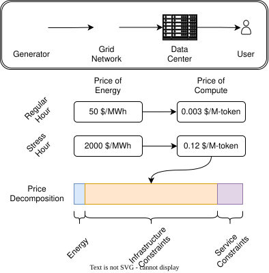

# Locational Marginal Pricing of Compute: Co-optimizing Compute and Energy for Transparent Data Center Flexibility

```
Note: the repository is being updated with additional comments.
```


Code for the paper *"Locational Marginal Pricing of Compute: Co-optimizing Compute and Energy for Transparent Data Center Flexibility"* by Vladimir Pyltsov and Teng Zeng ([arXiv](https://arxiv.org/pdf/2611.20116)).

We clear compute and electricity in a single linear program. The compute price is the dual of the binding constraints, so it follows real-time grid and data center conditions. It also splits into components that show what makes compute expensive:

- **Grid energy:** the system electricity price
- **Grid congestion:** the local electricity price premium
- **Site power:** the data center's power limit
- **GPU scarcity:** the available GPUs
- **SLO headroom:** spare capacity reserved to meet queueing-delay targets



## A simple example

Suppose a GPU draws 700 W for 30 ms to generate 100 output tokens:

$$
\frac{700\ \text{W} \times 0.03\ \text{s}}{100\ \text{tokens}} = 0.21\ \text{J/token}
$$

With electricity at $50/MWh (1 MWh = 3.6 × 10⁹ J), the energy cost per million tokens is:

$$
0.21 \times 10^6\ \text{J} \times \frac{\$50}{3.6 \times 10^9\ \text{J}} \approx \$0.003\ \text{per M tokens}
$$

If scarcity raises the electricity price to $2,000/MWh, this cost rises to about $0.12 per M tokens. When GPUs or site power run short, the price rises further, and the decomposition shows which constraint is responsible.

## Reproducing the results

Run the three notebooks in order. The main assumptions, such as the event settings, latency targets, bid prices, and site sizes, are defined near the top of each notebook. To run on Google Colab, uncomment the Drive-mounting lines at the top of each notebook.

| Step | Notebook | What it does | Outputs |
|---|---|---|---|
| 1 | `IEEEBusSystem.ipynb` | Builds the IEEE 30-bus DC-OPF in PTDF form, verifies it against PyPSA, and draws the network figure (Fig. 1) | `ieee30_grid.npz`, `fig_ieee30.pdf` |
| 2 | `DemandProfile.ipynb` | Builds request classes, GPU operating modes, queueing headroom, site sizing, and hourly demand from the Azure and ML.ENERGY data | `modes.csv`, `request_coefficients.csv`, `demand_req_s.npy`, `demand_params.json` |
| 3 | `PuttingTogether.ipynb` | Runs the joint compute and grid clearing, the scarcity events, and the price decomposition | `fig_clearing.pdf` (Fig. 2), `fig_price_day.pdf` (Fig. 3), `fig_decomposition.pdf` (Fig. 4), plus `fig_slo_sweep.pdf` and `fig_input_output.pdf` (additional analyses, not in the paper) |

## Setup

Python 3.10 or later is recommended.

```bash
pip install -r requirements.txt
```

All optimization problems use the open-source [HiGHS](https://highs.dev) solver through CVXPY.

## Data

| Data | Source | Notes |
|---|---|---|
| IEEE 30-bus system (Alsac–Stott) | [PGLib-OPF](https://github.com/power-grid-lib/pglib-opf) | Downloaded automatically by `IEEEBusSystem.ipynb` |
| LLM inference traces | [Azure LLM Inference Dataset 2024](https://github.com/Azure/AzurePublicDataset/blob/master/AzureLLMInferenceDataset2024.md) | Place `AzureLLMInferenceTrace_conv_1week.csv` and `AzureLLMInferenceTrace_code_1week.csv` in the repository root |
| GPU energy and throughput | [ML.ENERGY](https://huggingface.co/ml-energy) | Requires a Hugging Face token with dataset access |

Create a `.env` file in the repository root for the Hugging Face token:

```
HF_TOKEN=your_token_here
```


## Citation

```bibtex
@article{pyltsov2026lmpcompute,
  title  = {Locational Marginal Pricing of Compute: Co-optimizing Compute and Energy for Transparent Data Center Flexibility},
  author = {Pyltsov, Vladimir and Zeng, Teng},
  year   = {2026},
  note   = {arXiv preprint arXiv:2611.20116}
}
```

## Acknowledgment

The authors disclose the use of Anthropic Claude to conduct this work. The usage included assistance in writing, literature review, methodology refinement, and code generation and editing. Conceptual ideas, experimental design, implementations, analyses, and conclusions are the authors’ own. The authors take responsibility for all mistakes.


